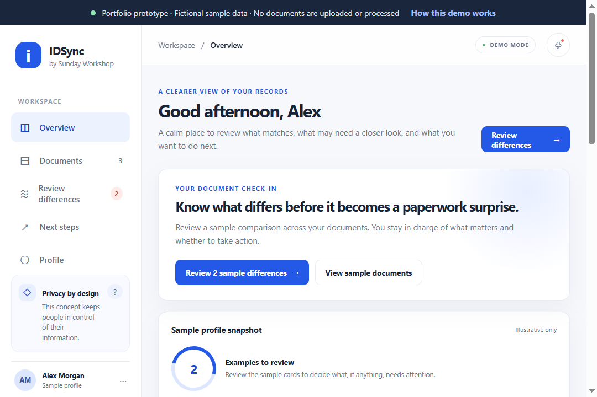

<div align="center">
  
  <h1>IDSync · Sunday Workshop</h1>
  <p><strong>Find the differences. Understand what matters. Choose what to do next.</strong></p>
  <p>A product-design case study and responsive prototype for a more thoughtful way to review differences across identity documents.</p>
  <p>
    <a href="https://github.com/Gigglinggarima/Workshop-on-PRD-to-GitHub"></a>
    
    
  </p>
</div>

<p align="center">
  
</p>
<p align="center"><sub>Screenshot of the implemented prototype · All names, records, and comparisons shown are fictional.</sub></p>

> **Portfolio concept only.** This static prototype does not accept, process, compare, or store identity documents. It is not affiliated with a government agency and does not provide official correction advice.

<p align="center">
  <a href="#try-the-demo">Try the demo locally</a> ·
  <a href="#the-case-study">Explore the case study</a> ·
  <a href="./DESIGN-REFERENCES.md">Browse the supplied screen concepts</a> ·
  <a href="#publish-to-github-pages">Publish with GitHub Pages</a>
</p>

## The case study

### The problem

Differences across official identity documents can go unnoticed until someone needs to use their information on a form or application. Finding a discrepancy late can mean extra paperwork, time, and effort. But not every difference is an error: harmless variations should not cause unnecessary alerts or anxiety.

### The opportunity

Help people review important details across documents in one place, see exactly what differs, understand why it may matter, and decide for themselves whether to take action.

### Product goals

- Identify meaningful differences across government-authorized identity documents.
- Make cross-checking easier with a unified document dashboard.
- Explain discrepancies and offer timely, non-authoritative guidance.
- Keep review and correction decisions in the user's hands.
- Minimize false, irrelevant, or unactionable alerts.

### Prioritization from the PRD

| Priority | Opportunity | Product intent |
| --- | --- | --- |
| **P0** | Cross-document consistency check | Compare important fields and surface meaningful differences early. |
| **P1** | Mismatch alerts and guidance | Explain a difference and help people consider appropriate next steps. |
| **P2** | Unified document dashboard | Bring reviewed documents and mismatch history into one place. |

The PRD supplies a RICE-inspired ordering, but no numeric RICE scores. These labels reflect that order rather than invented scores.

### Experience principles

1. **Explain, don't just flag.** Show which example records and fields were compared.
2. **Treat differences with care.** A difference is not automatically an error or a reason to act.
3. **Keep people in control.** The user decides what to review, dismiss, or do next.
4. **Be transparent about limitations.** A concept prototype is not a verified identity service.
5. **Design for sensitive information.** Establish security, privacy, consent, and retention requirements before handling real records.

## Explore the prototype

The responsive experience includes:

- **Overview** — At-a-glance fictional sample data with clear routes into the review flow.
- **Documents** — A small sample vault; add-record interaction is fictional and in-memory only.
- **Differences** — Filter hand-authored examples, inspect comparison explanations, and try review or dismissal actions.
- **Next steps** — A non-jurisdiction-specific checklist that keeps correction decisions with the user.
- **Profile** — A sample vault, illustrative review activity, explicit data-handling disclosures, and a demo-only preference toggle.

The project uses plain HTML, CSS, and JavaScript. There is no build step, JavaScript package dependency, backend, authentication, analytics, document upload, OCR, or government/third-party connection. The interface uses system fonts.

## Try the demo

### Open locally

1. Clone or download the repository.
2. Open `index.html` in a modern browser.
3. Explore the desktop sidebar or the mobile bottom navigation.

Or start a local static server from the project folder:

```powershell
py -m http.server 8000
```

Then visit <http://localhost:8000>.

### Demo interactions

- Navigate between the five sample views.
- Filter difference examples by review status.
- Mark an example reviewed or dismiss it; the result only changes in the current page session.
- Open explanation dialogs.
- Add a fictional record from the Documents view.
- Toggle the sample alert preference in Profile; it does not send a notification or persist.

## Design references

The supplied website and mobile screen concepts informed the visual direction and journeys. See the [screen reference gallery](./DESIGN-REFERENCES.md) for the original artifacts.

The concepts are **design references, not screenshots or proof of working features**. Some source screens contain claims about encryption, compliance, temporary processing, accuracy, integrations, or correction timelines that have not been verified. This prototype intentionally does not present those claims as product facts.

## Success measures from the PRD

- Meaningful mismatches identified and resolved by users.
- Reduced average time and cost to correct mismatches.
- B2B organizations adopting the platform for document-data verification.
- **Counter-metric:** Percentage of flags later confirmed to be valid or harmless differences.

The PRD does not define metric methods or targets. Demo counts and sample states are illustrative, not research findings or measured outcomes.

## Publish to the target GitHub repository

The target repository is [`Gigglinggarima/Workshop-on-PRD-to-GitHub`](https://github.com/Gigglinggarima/Workshop-on-PRD-to-GitHub). It is currently empty. From the project folder, initialize the local repository and push the first commit:

```powershell
git init -b main
git add .
git commit -m "Create IDSync portfolio case study"
git remote add origin https://github.com/Gigglinggarima/Workshop-on-PRD-to-GitHub.git
git push -u origin main
```

If your Git version does not support `git init -b main`, use `git init` followed by `git branch -M main` before adding and committing files.

### Enable the live demo

After the first push:

1. Open the repository's **Settings → Pages**.
2. Under **Build and deployment**, select **Deploy from a branch**.
3. Choose branch `main` and folder `/ (root)`, then save.
4. Wait for the Pages deployment to finish. The demo will then be available at <https://gigglinggarima.github.io/Workshop-on-PRD-to-GitHub/>.

The site uses relative asset paths and can be hosted at the repository's Pages subpath.

## Repository map

```text
.
├── index.html             # Static prototype shell and accessible dialog
├── styles.css             # Responsive layout, components, and visual tokens
├── app.js                 # Fictional sample data, views, and interactions
├── favicon.svg            # IDSync project mark
├── assets/
│   └── idsync-overview.png # Screenshot of the implemented prototype
├── context.md             # Product context derived from the PRD
├── plan.md                # Phases, acceptance checklist, and risks
├── DESIGN-REFERENCES.md   # Gallery of supplied screen concepts
├── PRD- Sunday Workshop Identity platform (1).docx
└── Prototype Screens/     # Supplied website and mobile references
```

## Scope, privacy, and limitations

The prototype's people, dates, masked IDs, record comparisons, and activity are made-up examples. Interactions change temporary page-session state only; there is no persistent storage or outbound API call in the app.

**Do not enter, upload, or share real identity information with this portfolio demo.** It cannot verify identity or correct records, and it is not affiliated with, endorsed by, or a substitute for a government authority.

Before any real-data product work, define the launch geography and document scope; obtain appropriate privacy, security, and legal review; establish consent, access, retention, and deletion rules; and validate extraction quality and false-alert rates using appropriately authorized data.

## What's next

Validate the intended audience, jurisdiction, document scope, and data-handling requirements. Define measurable quality thresholds and field-comparison rules, then test the journey with representative users. Only after those decisions should a production stack or real-data MVP be selected.

See [context.md](./context.md) for open questions and [plan.md](./plan.md) for phased exit criteria.

## Source material

- Product requirements: [`PRD- Sunday Workshop Identity platform (1).docx`](<./PRD- Sunday Workshop Identity platform (1).docx>)
- Supplied mockups: [`Prototype Screens/`](<./Prototype Screens/>)
- Linked design reference: [Sunday Workshop in Google Stitch](https://stitch.google.com/projects/13315518883121921507?pli=1)

## License

No license has been selected. Unless a license is added, this repository does not grant permission to reuse or redistribute its contents.
